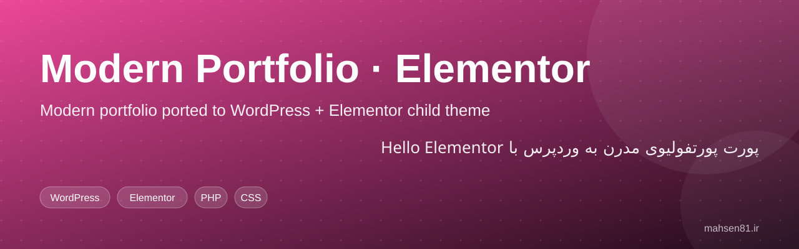

<!-- gen:header -->
<p align="center"></p>

<h1 align="center">Modern Portfolio · Elementor</h1>
<p align="center"><b>پورت پورتفولیوی مدرن به وردپرس با Hello Elementor</b><br><i>Modern portfolio ported to WordPress + Elementor child theme</i></p>
<p align="center">   </p>

<div dir="rtl">

## ✨ امکانات

- Child theme با انیمیشن و RTL
- قالب‌های آماده‌ی import در المنتور
- شورت‌کدهای اختصاصی

</div>

## 🚀 Quick start

```bash
Install hello-child-mj/ as a theme → import elementor/templates/
```

---

<!-- gen:docs -->
## 📚 مستندات کامل · Full documentation

# Modern Portfolio → WordPress (Hello Elementor + Elementor)

پورت پورتفولیوی Next.js به **WordPress + Hello Elementor + Elementor** با child theme برای انیمیشن‌ها و شل سایت.

Path: `C:\Users\mjpt1\Desktop\job\new\modern-portfolio-elementor\`

## What’s included

| Path | Description |
|------|-------------|
| `hello-child-mj/` | Child theme of **Hello Elementor** (CSS tokens, RTL, fonts, JS animations, shortcodes, partials) |
| `hello-child-mj/assets/img/` | Copied demo media (avatar, thumbs, bulb, circles, …) |
| `elementor/templates/` | Importable Elementor page JSON (shortcode widgets) |
| `elementor/html-widgets/` | Paste-ready HTML notes for Elementor HTML widget |
| `demo/` | Install guide (FA+EN), media mirror, content notes |

## Quick install (LocalWP / XAMPP)

1. Install WordPress (LocalWP recommended).
2. Install & activate plugins: **Elementor** (Free). Optional: Contact Form 7 or WPForms Lite.
3. Install **Hello Elementor** parent theme (Appearance → Themes → Add New).
4. Copy folder `hello-child-mj` into `wp-content/themes/`.
5. Activate **Hello Child MJ Portfolio**.
6. Theme activation creates pages: Home, About, Services, Work, Testimonials, Contact and sets Home as front page.
7. Open each page → **Edit with Elementor** (optional polish). Or import JSON from `elementor/templates/`.
8. Upload images from `demo/media/` to Media Library if you rebuild sections manually.

جزئیات فارسی: [`demo/README-INSTALL.md`](demo/README-INSTALL.md)

## Animations (child theme — works on Elementor Free)

| Effect | Implementation |
|--------|----------------|
| Home particles | tsparticles CDN + `assets/js/particles.js` |
| Content fade-in | `mj-fade` + IntersectionObserver (`fade-in.js`) |
| Purple page wipe | 3-layer CSS + `page-transition.js` (Framer Transition port) |
| Services / Work / Testimonials sliders | Swiper 11 CDN + `swiper-init.js` |
| About counters | `countup.js` + FA/EN digits |
| About tabs | `tabs.js` |
| Project hover overlays | CSS in `portfolio.css` |
| Locale FA/EN + RTL | `locale.js` + `.mj-only-fa` / `.mj-only-en` |
| Header + icon nav | Injected by child theme (`wp_body_open`) |

## Elementor Free vs Pro

| Feature | Free | Pro |
|---------|------|-----|
| Layout / headings / HTML / shortcode | ✅ | ✅ |
| Motion Effects (entrance animations) | ❌ — use child `mj-fade` | ✅ optional |
| Form widget | ❌ — CF7 / WPForms / demo stub | ✅ Elementor Form |
| Theme Builder header/footer | ❌ — child theme shell | ✅ can replace shell |
| Carousel widget | ✅ basic | ✅ — Swiper in child is closer to original |

**Honest note:** Full visual parity for page wipe, particles, and bilingual toggle is intentionally in the **child theme**, not Elementor Motion Effects. Elementor is the page editor; the child theme is the motion/shell layer.

## How to edit demo content

### A) Shortcode + PHP partials (fastest)

Edit bilingual copy in:

- `hello-child-mj/partials/home.php`
- `about.php`, `services.php`, `work.php`, `testimonials.php`, `contact.php`

Each string has `mj-only-fa` / `mj-only-en` (or block variants). Locale switcher toggles visibility.

### B) Elementor widgets (visual editor)

1. Edit page with Elementor.
2. Keep or replace `[mj_*]` Shortcode widget.
3. To edit visually: delete shortcode → add Heading / Text / HTML.
4. For bilingual: put both languages in the widget with classes:

```html
<span class="mj-only-fa">متن فارسی</span>
<span class="mj-only-en">English text</span>
```

5. Update social links in `functions.php` → `mj_render_site_shell()`.
6. Update project thumbnails/links in `partials/work.php`.

## Branding

- FA: محسن جباره اصل  
- EN: Mohsen Jabbarehasl  
- Colors: primary `#131424`, secondary `#393A47`, accent `#F13024`  
- Fonts: Vazirmatn (FA), Sora (EN)

## Limitations

- Parent theme **Hello Elementor** must stay installed.
- Google Fonts / jsDelivr CDNs may need a mirror in Iran (Bunny Fonts / local copies).
- Demo contact form does not email — wire CF7 or Elementor Pro Form.
- Elementor JSON templates are shortcode wrappers (reliable import); full widget-tree kits are fragile to hand-author.
- Some Next.js icon packs replaced with SVG/unicode equivalents.
- Full-viewport `overflow` behavior differs slightly on mobile WP admin bar.

## Source

Ported from `modern-portfolio` (Next.js) locales, layout, and Framer/Swiper/particles behavior.

---

<p align="center">ساخته‌شده توسط <a href="https://mahsen81.ir"><b>محسن جباره‌اصل</b></a> — برنامه‌نویسی، طراحی سایت، ربات و هوش مصنوعی<br>
Built by <a href="https://mahsen81.ir">Mohsen Jabbareh-Asl</a> · ⭐ اگر مفید بود، ستاره بدهید · Need a custom version? <a href="https://mahsen81.ir">Get in touch</a></p>
